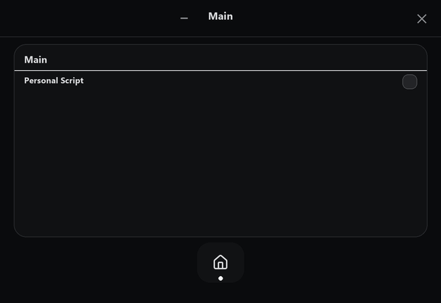

# AOT2 Cheat

A customizable C++17 Windows cheat for **Attack on Titan 2: Final Battle**, intended for offline single-player use. The source is free to customize under the MIT License. Feature signatures and behavior are based on the supplied Cheat Engine table.



The [interactive interface preview](docs/demo.html) is included for local use; open the downloaded file in a browser.

## What it includes

- Minimal frameless Win32 interface with category navigation and inline Player Data editing.
- Automatic `AOT2_EU.exe` detection and safe process-handle management.
- Native C++ implementations for the options represented in the launcher, with signature and original-byte checks before patching.
- Feature cleanup restores original bytes when the game process is still available.
- Press **F5** to retry process and signature discovery.

This is an offline, single-player AOT2 cheat. Customize the C++ source for your own setup. Disable matching Cheat Engine scripts before using the launcher so two trainers do not patch the same code locations.

The project is released under the MIT License. Lucide icons keep their separate ISC license in `assets/lucide/`.

## Download

Get the latest portable **Windows x64** build from [GitHub Releases](https://github.com/333sematary/aot2-launcher/releases/latest). Extract the ZIP and run `Launcher.exe` from the extracted folder. The bundled `assets/icons/` directory must stay beside the executable.

The launcher uses Win32 APIs and is currently Windows-only; no Linux binary is provided.

## Build

Requirements: Windows 10/11, Visual Studio 2022 with **Desktop development with C++**, and CMake.

```powershell
cmake -S . -B build -G "Visual Studio 17 2022" -A x64
cmake --build build --config Release
```

The executable is created at `build/Release/Launcher.exe`.

## Project layout

- `src/main.cpp` — Win32 interface and editable value controls.
- `src/process_manager.*` — process detection, signature scanner, validated memory operations, and patch restoration.
- `src/feature_controller.*` — C++ feature hooks and native option handlers.
- `assets/icons/` — Lucide navigation icons (ISC license).
- `docs/demo.html` and `docs/demo.gif` — preview matching the launcher's real startup and category flow.

## Credits

Navigation icons from [Lucide](https://lucide.dev/), ISC licensed; see `assets/lucide/LICENSE`.
